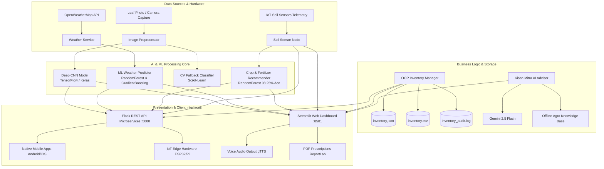

# AI-Powered Smart Farm Assistant

## Project Overview

The **AI-Powered Smart Farm Assistant** is designed to help farmers monitor crop health, forecast weather conditions, and manage farm inventory efficiently using machine learning, data visualization, and modern web interfaces.

Key highlights include:
- **Weather Forecasting:** Predicts local temperature and rainfall trends using ML and live API data.
- **Crop Disease Detection:** Classifies plant leaf diseases with deep learning (CNN) from uploads or camera photos.
- **Smart Inventory Management:** Tracks fertilizers, pesticides, and seeds with automatic low-stock alerts.
- **Web Dashboard & API:** Streamlit user interface and Flask REST API for mobile app and IoT integration.

---

## Key Features

- **Weather Forecasting & ML Prediction:**
  - Real-time meteorological data via **OpenWeatherMap API** with an **Offline Agro-Meteorological Simulator** fallback.
  - Temperature regression ($R^2 \approx 0.93$, $\text{MAE} \approx 1.46^\circ\text{C}$) using `RandomForestRegressor` and `GradientBoostingRegressor`.
  - Rainfall probability (%) and volume (mm) forecasting via `RandomForestClassifier` and `GradientBoostingRegressor`.
  - Visual analytics with **Matplotlib** and **Seaborn** (annual envelopes, correlation heatmaps, KDE rainfall densities, seasonal boxplots).

- **Crop Disease Detection (TensorFlow/Keras CNN):**
  - Deep learning CNN classifying **12 disease classes** across **Tomato**, **Potato**, **Corn**, and **Rice** (Early Blight, Late Blight, Common Rust, Northern Leaf Blight, Blast, Brown Spot, and healthy foliage).
  - Multi-modal input via file upload (JPG/PNG), live camera capture, and an **interactive sample gallery** with 12 leaf specimens.
  - Generates pathology reports with pathogen identification, organic bio-remedies (*Trichoderma*, Neem oil), chemical fungicides (*Mancozeb*, *Azoxystrobin*), and Pre-Harvest Intervals (PHI).

- **ML Crop & Fertilizer Recommender:**
  - Crop suitability classifier using `RandomForestClassifier` (**98.25% accuracy**) across 19 crops based on NPK, pH, temperature, humidity, and rainfall.
  - Fertilizer engine calculating exact dosages for **Neem Coated Urea (46% N)**, **DAP (18-46-0)**, and **MOP Potash (60% K2O)** in kg/ha and bags with application schedules.

- **Smart Inventory Management:**
  - Built with object-oriented programming (`InventoryManager`, `InventoryItem`).
  - Safe stock operations protected by custom exceptions: `ItemNotFoundError`, `InsufficientStockError`, `InvalidItemDataError`, and `StorageCorruptedError`.
  - Dual CSV and JSON data persistence (`inventory.json`, `inventory.csv`) with audit logging (`inventory_audit.log`).

- **IoT Soil & Automated Irrigation Monitor:**
  - Real-time telemetry monitoring soil moisture, temperature, pH, electrical conductivity (EC), and NPK levels.
  - Evapotranspiration water deficit calculation (L/ha) and automated solenoid valve control with 68% field capacity auto-shutoff.

- **Kisan Mitra: AI Farm Advisor:**
  - Multi-turn conversational assistant powered by **Google Gemini 2.5 Flash** (`google-genai` SDK).
  - Integrated offline knowledge engine with 50+ topics covering organic recipes (*Jeevamrutha*, *Panchagavya*), Integrated Pest Management (IPM), and government schemes (PM-KISAN, PMFBY).

---

## Datasets Used

- **Plant Leaf Pathology Dataset:**
  - **Source:** [PlantVillage Dataset](https://www.kaggle.com/datasets/emmarex/plantdisease) (Kaggle)
  - **Usage:** 12 pathological and healthy foliage classes across **Tomato**, **Potato**, **Corn**, and **Rice** (Early Blight, Late Blight, Common Rust, Northern Leaf Blight, Blast, Brown Spot) used to train the TensorFlow/Keras CNN and fallback classifier.

- **Crop Recommendation Dataset:**
  - **Source:** [Kaggle Crop Recommendation Dataset](https://www.kaggle.com/datasets/atharvaingle/crop-recommendation-dataset) (Kaggle)
  - **Usage:** 1,140 agricultural observations with soil N, P, K, pH, temperature, humidity, and rainfall across 19 crops used to train the crop suitability model (98.25% accuracy).

- **Historical & Live Meteorological Data:**
  - **Source:** [OpenWeatherMap API](https://openweathermap.org/api) & 3-Year Daily Agro-Climatic Dataset (`data/historical_weather.csv`)
  - **Usage:** Live weather telemetry combined with 1,095 daily historical observations to train the `RandomForestRegressor`, `GradientBoostingRegressor`, and `RandomForestClassifier` for temperature and rain predictions.

- **Fertilizer & Soil Nutrient Database:**
  - **Source:** [Indian Council of Agricultural Research (ICAR)](https://icar.org.in/) & [Ministry of Agriculture & Farmers Welfare](https://agricoop.nic.in/)
  - **Usage:** Crop-specific nutrient uptake guidelines used to calculate exact fertilizer deficits and dosage requirements (Neem Coated Urea, DAP, and MOP).

- **Curated Leaf Specimen Gallery:**
  - **Source:** Verified Agricultural Pathology Field Reference Specimens (`data/sample_leaves/`)
  - **Usage:** 12 specimen images for instant 1-click diagnostic demonstration in the web dashboard.

- **Agronomic Knowledge Base:**
  - **Source:** [TNAU Agritech Portal](https://agritech.tnau.ac.in/) & Government Portals ([PM-KISAN](https://pmkisan.gov.in/), [PMFBY](https://pmfby.gov.in/))
  - **Usage:** 50+ topics covering organic recipes (*Jeevamrutha*, *Panchagavya*), Integrated Pest Management (IPM), and welfare schemes for the Kisan Mitra AI Advisor.

---

## System Architecture



---

## Repository Structure

```
AI_SmartFarm_Assistant/
├── app.py                         # Streamlit Interactive Web Dashboard(Port 8501)
├── api_server.py                  # Flask REST API Microservices Server(Port 5000)
├── requirements.txt               
├── README.md                     
├── .gitignore                    
│
├── data/
│   ├── historical_weather.csv     # 3-year daily meteorological dataset(1,095 rows)
│   ├── crop_recommendation.csv    # Multi-variable soil-climatic dataset(1,140 rows)
│   ├── inventory.json             
│   ├── inventory.csv              
│   ├── inventory_audit.log        
│   ├── crop_disease_dataset/      # Class-partitioned image training dataset
│   └── sample_leaves/             # 12 Curated specimen leaves
│
├── models/
│   ├── disease_detector.py        # CNN architecture,training & evaluation pipeline
│   ├── weather_predictor.py       # ML temperature & rainfall models
│   ├── crop_fertilizer_recommender.py # ML crop suitability & fertilizer engine
│   ├── crop_disease_cnn.keras     # Trained CNN model weights
│   ├── crop_disease_fallback.joblib # Computer vision fallback classifier
│   ├── crop_recommender.joblib    # Serialized crop suitability model(98.25% acc)
│   ├── weather_ml_models.joblib   # Serialized weather ML regressors
│   └── disease_model_meta.json    # CNN training history & evaluation metrics
│
├── modules/
│   ├── __init__.py
│   ├── inventory_manager.py       # OOP Inventory Manager
│   ├── weather_service.py         # OpenWeatherMap API & micro-climate simulator
│   ├── disease_classifier.py      # Leaf inference & pathology knowledge base
│   ├── iot_soil_monitor.py        # IoT telemetry simulator & irrigation logic
│   ├── farm_advisor.py            # Gemini 2.5 Flash & Offline Knowledge Bot
│   └── audio_advisor.py           # Text-to-Speech (gTTS) audio voice synthesis
│
├── static/
│   └── style.css                  # UI styling
│
├── utils/
│   ├── __init__.py
│   ├── dataset_generator.py       # Synthetic weather data & specimen leaf renderer
│   ├── pdf_generator.py           
│   └── visualizer.py              
│
└── tests/
    └── test_smartfarm.py          
```

---

## Machine Learning Models & Evaluation

| Model Name | Task | Algorithm / Architecture | Key Performance Metrics |
|---|---|---|---|
| **Crop Disease CNN** | Foliar Disease Diagnosis | Deep CNN (Conv2D, BatchNorm, Dropout, Softmax) | **91.96% Training Accuracy**, 12 Classes |
| **Crop Recommender** | Soil-to-Crop Suitability | `RandomForestClassifier` (100 Estimators) | **98.25% Accuracy**, 19 Crop Classes |
| **Temperature Regressor** | 7-Day Temp Trajectory | `RandomForestRegressor` with Lag Features | **$R^2 = 0.9256$**, **$\text{MAE} = 1.462^\circ\text{C}$** |
| **Rain Occurrence Classifier** | Rain Event Detection | `RandomForestClassifier` | **$\text{Accuracy} = 65.0\%$**, **$\text{Precision} = 60.0\%$** |
| **Precipitation Regressor** | Rainfall Volume (mm) | `GradientBoostingRegressor` | **$\text{Volume MAE} = 17.6\text{ mm}$** |
| **CV Fallback Classifier** | Failsafe Disease Diagnosis | Random Forest on HSV/RGB Spatial Histograms | **98.0% Accuracy** on Specimen Dataset |

---

## Technology Stack

| Domain | Technology / Framework | Purpose |
|---|---|---|
| **Language** | Python 3.11 | Core OOP architecture, dataclasses, and custom exceptions |
| **Deep Learning** | TensorFlow 2.21, Keras 3.15 | Multi-class Convolutional Neural Network for plant disease classification |
| **Machine Learning** | Scikit-learn 1.9, Joblib | Random Forests, Gradient Boosting, Train/Test validation, Metrics |
| **Web Dashboard** | Streamlit 1.66 | Modern responsive frontend with 11 specialized agronomic tabs |
| **REST API Server** | Flask 3.1, Flask-CORS 6.0 | Microservices backend for Mobile Apps and IoT Hardware |
| **Data Science** | Pandas 3.0, NumPy 2.4, SciPy | Temporal lag feature engineering, cyclical transforms, analytics |
| **Visualizations** | Matplotlib 3.11, Seaborn 0.13, Plotly 7.1 | Annual trajectories, correlation heatmaps, KDE distributions, treemaps |
| **Voice & PDF** | gTTS 2.5, ReportLab 5.0 | Speech audio synthesis and official PDF prescription sheets |
| **Generative AI** | Google Gemini 2.5 Flash (`google-genai`) | Multi-turn conversational AI consultant with offline fallback |
| **APIs** | OpenWeatherMap API | Live global weather telemetry |

---

## Quickstart & Installation

### 1. Clone & Set Up Environment
```bash
# Clone the repository
git clone https://github.com/yasaswivenkat/AI_Smartfarm_Assistant.git
cd AI_Smartfarm_Assistant

# Create and activate virtual environment
python -m venv .venv
.\.venv\Scripts\activate      # Windows
# source .venv/bin/activate    # Linux / macOS

# Install dependencies
pip install -r requirements.txt
```

### 2. Launch the Web Dashboard
```bash
streamlit run app.py
```
Open **[http://localhost:8501](http://localhost:8501)** in your browser.

### 3. Launch the REST API Server (Optional)
```bash
python api_server.py
```
API endpoints and documentation will be accessible at **[http://localhost:5000](http://localhost:5000)**.

---

## API Documentation

The Flask backend provides RESTful JSON endpoints at `http://localhost:5000` with CORS support for mobile applications and IoT hardware integration.

| Method | Endpoint | Description | Sample Request / Query |
|---|---|---|---|
| `GET` | `/api/health` | System status and active ML models check | None |
| `GET` | `/api/weather/current` | Current meteorological observations | `?city=Bangalore` |
| `GET` | `/api/weather/predict` | 7-day ML weather prediction | `?days=7` |
| `POST` | `/api/crop/disease/predict` | Upload leaf image for CNN diagnosis | Multipart `form-data` with `image` |
| `GET` | `/api/crop/recommend` | ML crop recommendation from soil test | `?n=80&p=40&k=40&ph=6.5&temp=25&hum=80&rain=180` |
| `POST` | `/api/crop/fertilizer/calculate` | Exact Urea, DAP, and MOP dosage calculation | `{"soil_n": 40, "soil_p": 20, "soil_k": 30, "target_crop": "Tomato"}` |
| `GET` | `/api/inventory` | Inventory list with low-stock badges | None |
| `POST` | `/api/inventory/use` | Deduct stock with custom exception handling | `{"item_id": "PEST-001", "quantity": 1.5, "purpose": "Blight spray"}` |
| `POST` | `/api/inventory/restock` | Replenish inventory supplies | `{"item_id": "FERT-001", "quantity": 10}` |
| `GET` | `/api/iot/telemetry` | Real-time IoT subsurface soil sensor telemetry | None |
| `POST` | `/api/iot/pump` | Automated irrigation solenoid valve toggle | `{"state": true}` |
| `POST` | `/api/advisor/chat` | AI chatbot agronomic guidance (Gemini / Offline) | `{"message": "How to control aphids organically?"}` |

---

## License & Acknowledgments

This project is licensed under the **MIT License** — see the [LICENSE](LICENSE) file for details.

Developed for farmers, agronomists, and smart agriculture researchers.
Contributions and pull requests are warmly welcomed!
